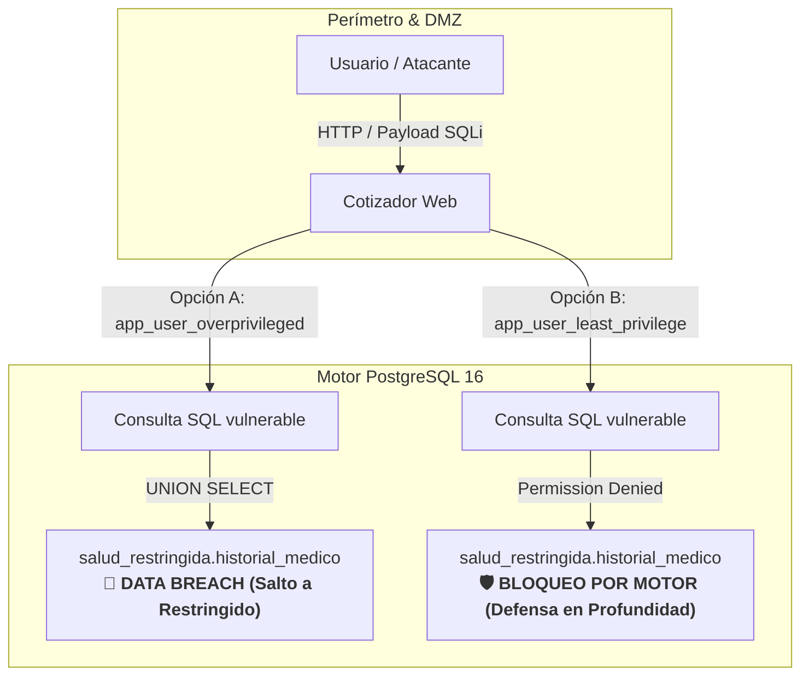

# Data Protection & Compliance — Sector Asegurador (Argentina)

[](LICENSE)
[](docs/ley-25326.md)
[](lab/README.md)

---

## De qué trata este proyecto

Armé este proyecto para bajar a tierra un problema clásico de seguridad y GRC (Gobierno, Riesgo y Cumplimiento) en el rubro asegurador argentino: la distancia que suele haber entre las políticas en papel ("cumplir con la Ley 25.326") y lo que pasa realmente en la base de datos cuando alguien programa mal un sistema.

En una compañía de seguros conviven dos mundos muy distintos:
1. Las pólizas comunes de autos o casas (**información confidencial**).
2. Los diagnósticos médicos de siniestros de ART o seguros de vida (**datos sensibles/restringidos** bajo el Art. 7 de la Ley 25.326).

Si un atacante encuentra una inyección SQL en el cotizador web público, ¿qué le impide saltar de una tabla de pólizas a leer los historiales médicos de los asegurados? Si la base de datos está conectada con un usuario con permisos amplios, absolutamente nada. La clasificación en un documento de Word no frena un ataque si no está implementada en los permisos del motor.

Para que esto no quede en un ensayo teórico, armé un **laboratorio ejecutable en Docker con PostgreSQL 16**:
- **Laboratorio Técnico Reproducible ([`lab/`](lab/README.md)):** Muestra en vivo cómo un ataque de SQLi (`UNION SELECT`) salta del esquema de pólizas al de salud si la app usa un usuario sobreprivilegiado, y cómo el motor de Postgres lo frena en seco con un error `SQLSTATE 42501 (INSUFFICIENT PRIVILEGE)` cuando aplicás mínimo privilegio (RBAC y esquemas separados), incluso con la web rota.
- **Defensa en Profundidad:** Demuestra la separación entre la solución en capa de software (consultas preparadas con `%s`) y la contención en capa de base de datos (segregación de esquemas y usuarios).

---

## El Problema: Del Cotizador a los Historiales Médicos

En una aseguradora, el cotizador web suele ser el front más expuesto. Si ese endpoint tiene una inyección SQL (`UNION SELECT`), el atacante intenta leer cualquier tabla del motor.



---

## Cómo Probar el Laboratorio (PostgreSQL 16)

El lab está armado para levantarse con Docker:

### 1. Levantar los contenedores:
```bash
docker compose -f lab/docker-compose.yml up -d
```
Esto levanta PostgreSQL 16 (con los esquemas `seguros_core` y `salud_restringida`, roles y datos de prueba ya cargados vía `init.sql`) y una app web en Flask.

### 2. Correr la prueba por consola:
Podés ejecutar el script de exploit directamente dentro del contenedor sin instalar nada en tu máquina:
```bash
docker compose -f lab/docker-compose.yml exec web python test_exploit.py
```

El script hace cuatro pasos:
1. Tira una consulta normal de póliza (`POL-2026-001`).
2. Tira el exploit con el usuario sobreprivilegiado y te muestra los diagnósticos médicos en pantalla (**Data Breach**).
3. Tira el mismo exploit con el usuario de mínimo privilegio y muestra cómo Postgres aborta la consulta con `SQLSTATE 42501 (INSUFFICIENT_PRIVILEGE)`.
4. Muestra la solución en el código usando consultas preparadas (`%s`).

### 3. Probarlo desde el navegador:
Abrí `http://localhost:5000` en tu navegador. Armé una interfaz visual donde podés alternar entre el usuario vulnerable y el seguro, probar payloads con un clic y ver qué responde la base de datos en vivo.

---

## Estructura del Repositorio

```text
data-protection-compliance/
│
├── README.md                      # Explicación general, arquitectura y guía rápida
├── LICENSE                        # Licencia MIT
│
├── docs/                          # Documentación de análisis y marco regulatorio
│   ├── data-classification.md     # Matriz de 4 niveles, análisis de impacto y caso La Segunda
│   ├── security-controls.md       # Controles técnicos (WORM, DLP, RLS) y fricciones operativas
│   ├── data-flow.md               # Flujo de datos, diagrama de arquitectura y mapeo MITRE ATT&CK
│   ├── ley-25326.md               # Ley 25.326, Res. AAIP 47/2018 y delitos informáticos (Ley 26.388)
│   └── gdpr-comparacion.md        # Comparación con GDPR, estatus de adecuación y notificación en 72h
│
└── lab/                           # Laboratorio técnico reproducible (PostgreSQL 16)
    ├── README.md                  # Instrucciones detalladas del lab
    ├── docker-compose.yml         # Contenedores de PostgreSQL 16 y Flask
    ├── .env.example               # Ejemplo de variables de entorno y nota sobre credenciales
    ├── test_exploit.py            # Script CLI para ejecutar y verificar la mitigación
    ├── app/                       # Código de la aplicación web Flask y dashboard interactivo
    │   ├── Dockerfile
    │   ├── requirements.txt
    │   ├── app.py                 # Servidor web Flask
    │   └── templates/
    │       └── index.html         # Frontend web para pruebas
    └── db/                        # DDL de PostgreSQL
        └── init.sql               # Esquemas segregados, datos sintéticos y roles con RBAC
```

---

## Controles y Secciones a Sumar (Roadmap a Futuro)

Este proyecto se enfoca en resolver la brecha entre la normativa de protección de datos personales y la base de datos (PostgreSQL 16). Para llevar este escenario a un nivel empresarial completo, se definen las siguientes líneas de trabajo y tecnologías a incorporar a futuro:

- **1. Infraestructura como Código (IaC) para Backups Inmutables (Terraform / AWS S3 WORM)**

- **2. Detección en Tiempo Real para SOC / SIEM (Reglas Sigma)**

- **3. Prevención de Fuga de Datos (DLP)**

- **4. Hardening Avanzado en PostgreSQL (Row-Level Security y Cifrado)**
---

## Decisiones de Diseño y Aprendizajes Técnicos

Durante el desarrollo del proyecto surgieron varios desafíos técnicos y de negocio que guiaron las decisiones de arquitectura:

1. **La importancia de contar con más controles que una sola tabla de permisos (Defensa en Profundidad):**  
   Verifiqué que una configuración de permisos básica o una tabla de control de acceso por sí sola no es suficiente si la aplicación web contiene fallas como SQL Injection. Si la app conecta con un usuario de permisos amplios, el atacante puede saltar a cualquier dato. Por eso es indispensable combinar controles en capas: consultas preparadas en el software para neutralizar la inyección en la entrada, junto con segregación de esquemas y usuarios con mínimo privilegio en PostgreSQL para contener el impacto si la aplicación falla.

2. **El conflicto entre derecho de supresión y retención legal en seguros:**  
   En una aseguradora, el derecho del titular a exigir la supresión de sus datos (Art. 16 Ley 25.326) entra en conflicto directo con las normativas de la Superintendencia de Seguros de la Nación (SSN) y los plazos de prescripción de siniestros (hasta 10 años en ART). Para resolverlo sin incumplir ninguna de las dos normativas, la salida técnica adecuada no es borrar físicamente el registro, sino aplicar **bloqueo y disociación** (*tombstoning*), restringiendo el acceso exclusivamente a requerimientos judiciales o periciales.

3. **Criterio de clasificación de 4 niveles adaptado al sector asegurador:**  
   Los esquemas habituales de 3 niveles (Público, Interno, Confidencial) suelen cometer el error de agrupar datos personales comunes (DNI, contacto) con información de salud. Un modelo de **4 niveles (Público, Interno, Confidencial y Restringido)** permite aislar bajo controles técnicos mucho más estrictos la información sensible amparada por el Art. 7 de la Ley 25.326 (historias clínicas, peritajes médicos de siniestros y diagnósticos de ART).

---

## Aclaraciones y Límites del Proyecto

- **Datos y Nombres Ficticios:** Todos los nombres, números de póliza y diagnósticos médicos del laboratorio son ficticios. El caso de *La Segunda Seguros* se toma como referencia exclusivamente a partir de notas de prensa y reportes públicos de 2023.
- **Credenciales en el Lab Local:** Las contraseñas están fijas en el código (`password_vulnerable_123`) a propósito para que el lab se pueda levantar y probar en local en un solo comando sin tener que armar un archivo `.env` o levantar un vault. En producción esto jamás se hace; se usan gestores de secretos (Vault / AWS Secrets Manager) o variables de entorno (ver [`lab/.env.example`](lab/.env.example)).
- **Alcance Legal:** Este trabajo es un ejercicio técnico y arquitectónico de seguridad informática; no reemplaza el dictamen de un abogado matriculado especialista en protección de datos personales.

---

## Fuentes Normativas Oficiales
- **Ley 25.326 — Protección de Datos Personales:** [InfoLEG](https://servicios.infoleg.gob.ar/infolegInternet/anexos/60000-64999/64790/texact.htm)
- **Ley 26.388 — Delitos Informáticos:** [InfoLEG](https://servicios.infoleg.gob.ar/infolegInternet/anexos/140000-144999/141790/norma.htm)
- **Resolución AAIP 47/2018 — Medidas de Seguridad:** [InfoLEG](https://servicios.infoleg.gob.ar/infolegInternet/anexos/310000-314999/312843/norma.htm)
- **Decisión de Adecuación UE 2003/490/CE (Ratificada 2024):** [EUR-Lex](https://eur-lex.europa.eu/legal-content/ES/TXT/?uri=CELEX%3A32003D0490)

---

## Autor
**Santiago D'Andrea**  
- GitHub: [@SantiagoDandrea](https://github.com/SantiagoDandrea)  
- Repositorio: [data-protection-compliance](https://github.com/SantiagoDandrea/data-protection-compliance)  
- Licencia: [MIT](LICENSE)
