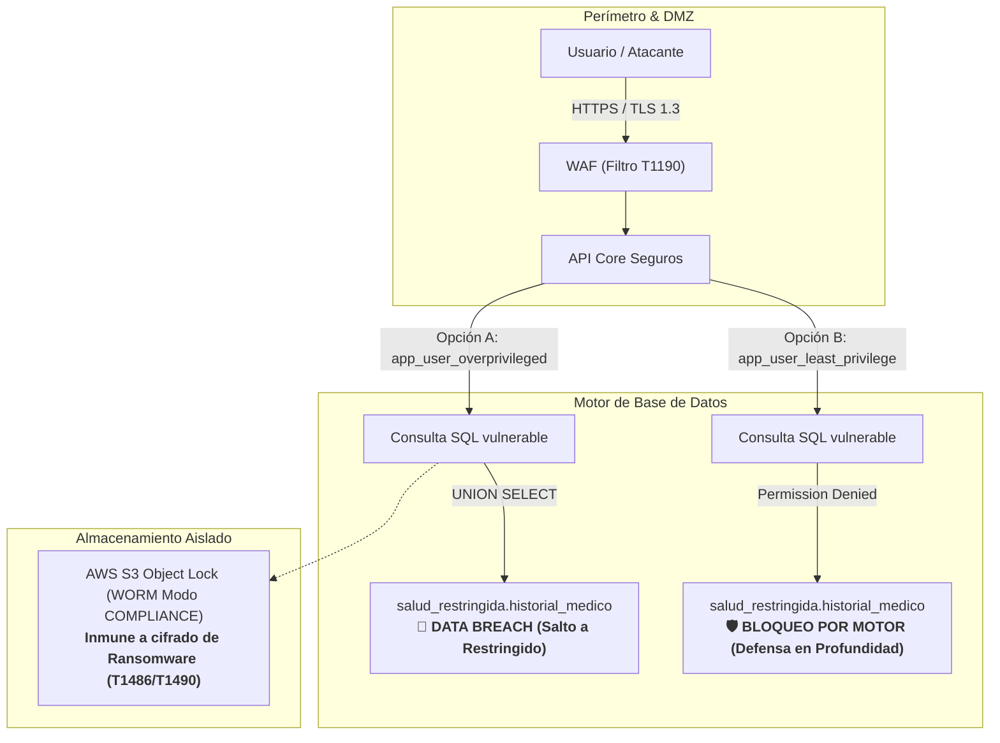

# Data Protection & Compliance — Sector Asegurador (Argentina)

[](LICENSE)
[](docs/ley-25326.md)
[](lab/README.md)

---

## Resumen Ejecutivo

Este repositorio presenta un marco de trabajo aplicado de **Gobierno, Riesgo y Cumplimiento (GRC) en Ciberseguridad y Arquitectura Técnica**, adaptado a la operatoria de una aseguradora argentina.

Las aseguradoras gestionan una combinación crítica de información: contratos y pólizas comerciales (**Confidencial**) junto a diagnósticos médicos de alta sensibilidad de siniestros laborales (ART) y seguros de vida (**Restringido** bajo la Ley 25.326 de Protección de Datos Personales).

En lugar de limitarse a un análisis teórico o documental, este proyecto conecta las obligaciones regulatorias con validación técnica reproducible:
- **Laboratorio Técnico Reproducible ([`lab/`](lab/README.md)):** Demuestra cómo una inyección SQL a nivel de aplicación (**MITRE ATT&CK T1190**) permite romper las fronteras de clasificación de datos y extraer registros de salud si la base de datos se consulta con una cuenta sobreprivilegiada, y cómo el **principio de mínimo privilegio (RBAC y aislamiento de esquemas)** frena el ataque en el motor de base de datos aun si el código web tiene vulnerabilidades.
- **Controles Prácticos de Muestra:** Reglas de DLP en regex ([`dlp_rules.json`](lab/controls/dlp_rules.json)), configuración de Terraform para buckets S3 con Object Lock en modo COMPLIANCE ([`terraform_s3_worm_backup.tf`](lab/controls/terraform_s3_worm_backup.tf)) como defensa contra ransomware (inspirado en el incidente de *La Segunda Seguros* de 2023) y scripts de hardening para PostgreSQL.
- **Detección para SOC:** Trazas sintéticas de muestra basadas en el escenario de ataque y una **regla Sigma** ([`sigma_sqli_detection.yml`](lab/detection/sigma_sqli_detection.yml)) para alertar en SIEM ante intentos de enumeración o SQLi.
- **Auditoría Legal:** Verificación con InfoLEG (plazos de los Arts. 14 y 16 de la Ley 25.326) y corrección de la reforma penal de la Ley 26.388 (derogación del Art. 117 bis y vigencia de los Arts. 153 bis y 157 bis del Código Penal).

---

## Planteo del Problema y Caso de Estudio

En una aseguradora argentina conviven dos realidades:
1. **Riesgos patrimoniales:** Automotores, hogar, comercio (datos de identificación y tarjetas de crédito).
2. **Riesgos sobre personas:** Seguros de vida y medicina laboral / accidentes de trabajo (**ART**), que concentran historiales clínicos, dictámenes de incapacidad y peritajes psicológicos.

Si un atacante explota una falla en el cotizador web público, ¿qué impide que salte de consultar una póliza automotor a extraer los diagnósticos oncológicos o psiquiátricos de los asegurados?



---

## Laboratorio Técnico Ejecutable (PostgreSQL 16)

El laboratorio convierte el caso práctico de análisis de riesgo en una **prueba de concepto funcional y verificable sobre un motor de base de datos empresarial real**.

### 1. Iniciar la base de datos y la aplicación (Docker Compose):
```bash
docker compose -f lab/docker-compose.yml up -d
```

### 2. Ejecutar la prueba técnica en terminal:
Puedes ejecutar el exploit directamente dentro del contenedor sin necesidad de configurar librerías locales:
```bash
docker compose -f lab/docker-compose.yml exec web python test_exploit.py
```
*(O desde tu entorno local si cuentas con `psycopg2-binary`: `python lab/test_exploit.py`)*

El script se conecta a PostgreSQL por TCP/IP, demuestra la exfiltración de historias clínicas bajo el rol `app_user_overprivileged` y comprueba cómo el motor de PostgreSQL arroja la excepción nativa **`42501 (INSUFFICIENT PRIVILEGE)`** cuando se ejecuta la misma consulta bajo el rol `app_user_least_privilege`.

### 3. Exploración interactiva en el Dashboard Web:
Accede desde tu navegador a `http://localhost:5000` para alternar roles de base de datos en caliente, inyectar payloads preconfigurados y analizar en vivo la telemetría del motor y el encuadre legal bajo la Ley 25.326.

---

## Estructura del Repositorio

```text
data-protection-compliance/
│
├── README.md                      # Resumen ejecutivo, arquitectura y guía rápida
├── CHANGELOG.md                   # Bitácora de iteraciones, correcciones normativas y versiones
├── LICENSE                        # Licencia MIT de código y documentación
│
├── docs/                          # Análisis GRC y fundamentación técnica
│   ├── data-classification.md     # Matriz de 4 niveles, análisis de riesgo y caso La Segunda Seguros
│   ├── security-controls.md       # Controles técnicos (WORM, DLP, RLS) y trade-offs operativos
│   ├── data-flow.md               # Arquitectura completa, mapeo MITRE ATT&CK y choke points
│   ├── ley-25326.md               # Marco legal argentino, Res. AAIP 47/2018 y reforma penal Ley 26.388
│   └── gdpr-comparacion.md        # Comparativa con GDPR, estatus de adecuación 2024 y resiliencia
│
└── lab/                           # Entorno técnico reproducible (PostgreSQL 16)
    ├── README.md                  # Manual del laboratorio y procedimientos de prueba
    ├── docker-compose.yml         # Orquestación de PostgreSQL 16 y Web App Flask
    ├── test_exploit.py            # Script CLI de prueba y verificación contra PostgreSQL
    ├── app/                       # Código de la aplicación Flask y dashboard web
    ├── db/                        # init.sql con esquemas segregados, datos y roles
    ├── controls/                  # Artefactos aplicados de seguridad
    │   ├── dlp_rules.json         # Reglas DLP con regex para DNI, CUIT y términos CIE-10
    │   ├── terraform_s3_worm_backup.tf # IaC para backups inmutables anti-ransomware
    │   └── postgres_hardening.sql # Hardening con Row-Level Security y esquemas en PostgreSQL
    └── detection/                 # Detección y reglas para SOC
        ├── sqli_waf.log           # Trazas sintéticas de muestra (WAF y auditoría de BD)
        └── sigma_sqli_detection.yml # Regla de detección Sigma para SIEM
```

---

## Qué Aprendí y Qué Haría Diferente (Notas de Autor)

Este proyecto nació para entender cómo las exigencias de leyes de datos terminan aterrizando en la práctica en sistemas reales. En el camino me encontré con varias cosas que no suelen verse en la teoría:

1. **La clasificación en papel no frena a nadie si la BD no está segmentada:**  
   Al principio pensé que bastaba con armar una tabla y decir "esto es Confidencial" y "esto es Restringido". Recién cuando armé el lab de SQLi entendí que si la app web conecta con un usuario que tiene `SELECT` sobre todas las tablas, la clasificación no existe para un atacante. La defensa real exige **roles y esquemas separados en la base de datos**.

2. **El conflicto entre borrar datos y tener que guardarlos por ley en seguros:**  
   Fue un dolor de cabeza entender cómo conjugar el derecho de supresión (Art. 16 Ley 25.326) con las exigencias de la SSN y la prescripción civil/laboral (que puede llegar a 10 años en ART). Un cliente puede pedir que borres todo, pero la aseguradora no puede destruir pólizas si hay un reclamo latente. La salida técnica que encontré es el **bloqueo y disociación** (*tombstoning*), dejando los datos aislados solo para requerimientos periciales o judiciales.

3. **El riesgo de armar demasiados niveles de clasificación:**  
   Primero quise copiar el modelo de 5 niveles del NIST/DoD, pero para una empresa privada es inmanejable y nadie lo cumple. Después quise simplificarlo a 3 (Público, Interno, Confidencial), pero cometí el error de mezclar el DNI de un cliente con un diagnóstico de quimioterapia. El esquema de **4 niveles** fue el punto medio justo para aislar los datos sensibles del Art. 7 de la Ley 25.326.

4. **Revisión normativa (y corregir un error propio):**  
   En los primeros borradores cité el Art. 117 bis del Código Penal como sanción penal. Al revisar en InfoLEG me di cuenta de que ese artículo fue **derogado en 2008 por la Ley 26.388 de Delitos Informáticos**, que incorporó los Arts. 153 bis (acceso ilegítimo) y 157 bis (difusión ilegítima). Reconocer ese error y documentarlo en el changelog fue parte del aprendizaje.

5. **El detalle de permisos de esquemas en PostgreSQL:**  
   Al configurar PostgreSQL pensé que con hacer `REVOKE ALL ON SCHEMA salud_restringida FROM app_user_least_privilege` el esquema quedaba aislado. Pero en Postgres los esquemas nuevos conceden el permiso `USAGE` por omisión al rol `PUBLIC`. Si no haces `REVOKE ALL ... FROM PUBLIC`, cualquier usuario sigue teniendo `USAGE` sobre el esquema. Aunque el exploit se bloqueaba igual porque la tabla no tenía `SELECT` otorgado a `PUBLIC` (el bloqueo venía de la falta de `GRANT`), el esquema seguía siendo visible. Entender esa herencia vía `PUBLIC` fue un aprendizaje clave de DBA.

---

## Alcance y Límites del Proyecto (Aclaraciones y Límites)

- **Caso de Estudio Hipotético:** Los nombres de asegurados, coberturas y números de póliza utilizados en el laboratorio y en la documentación son completamente ficticios y creados con fines didácticos. El caso de *La Segunda Seguros* se analiza exclusivamente en base a reportes y coberturas de prensa pública.
- **Entorno de Laboratorio:** La aplicación incluida en `lab/app/` contiene deliberadamente vulnerabilidades de inyección SQL con propósitos educativos y de concientización. No debe utilizarse en entornos productivos ni exponerse a redes públicas sin los controles mitigantes activados.
- **Asesoramiento Legal:** Este repositorio constituye un ejercicio técnico y arquitectónico de seguridad de la información; no reemplaza el dictamen ni la auditoría formal de un profesional del derecho matriculado en materia de protección de datos personales.

---

## Fuentes Normativas Oficiales
- **Ley 25.326 — Protección de Datos Personales:** [InfoLEG](https://servicios.infoleg.gob.ar/infolegInternet/anexos/60000-64999/64790/texact.htm)
- **Ley 26.388 — Delitos Informáticos:** [InfoLEG](https://servicios.infoleg.gob.ar/infolegInternet/anexos/140000-144999/141790/norma.htm)
- **Resolución AAIP 47/2018 — Medidas de Seguridad:** [InfoLEG](https://servicios.infoleg.gob.ar/infolegInternet/anexos/310000-314999/312843/norma.htm)
- **Decisión de Adecuación UE 2003/490/CE (Ratificada 2024):** [EUR-Lex](https://eur-lex.europa.eu/legal-content/ES/TXT/?uri=CELEX%3A32003D0490)

---

## Autor y Contacto
**Santiago D'Andrea**  
- GitHub: [@SantiagoDandrea](https://github.com/SantiagoDandrea)  
- Repositorio: [data-protection-compliance](https://github.com/SantiagoDandrea/data-protection-compliance)  
- Licencia: [MIT](LICENSE)
