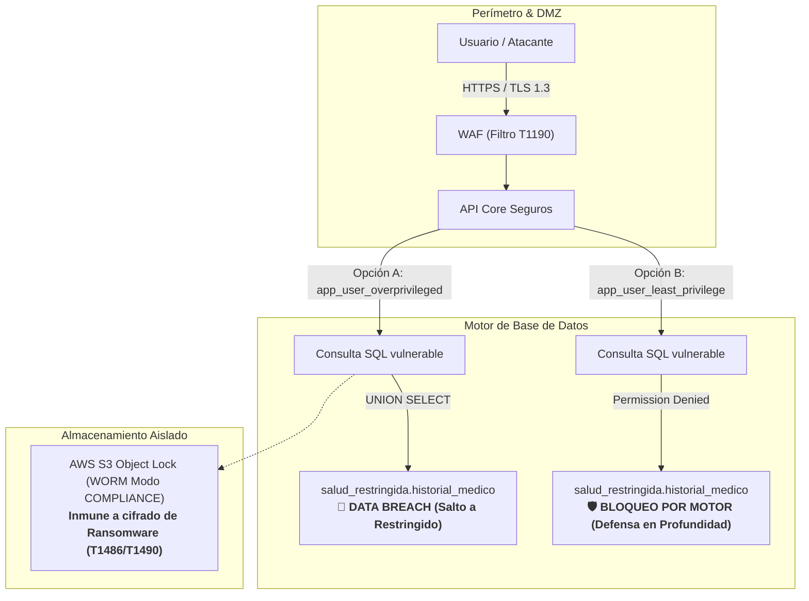

# Data Protection & Compliance — Sector Asegurador (Argentina)

[](LICENSE)
[](docs/ley-25326.md)
[](lab/README.md)

---

## Resumen Ejecutivo

Este repositorio presenta un marco de trabajo aplicado de **Gobierno, Riesgo y Cumplimiento (GRC) en Ciberseguridad y Arquitectura Técnica**, adaptado a la operatoria de una aseguradora argentina.

Las aseguradoras gestionan una combinación crítica de información: contratos y pólizas comerciales (**Confidencial**) junto a diagnósticos médicos de alta sensibilidad de siniestros laborales (ART) y seguros de vida (**Restringido** bajo la Ley 25.326 de Protección de Datos Personales).

En lugar de limitarse a un análisis teórico o documental, este proyecto conecta las obligaciones regulatorias con validación técnica reproducible:
- **Laboratorio Técnico Reproducible ([`lab/`](lab/README.md)):** Demuestra cómo una inyección SQL a nivel de aplicación (**MITRE ATT&CK T1190**) permite vulnerar las fronteras de clasificación de datos y exfiltrar registros de salud si se utiliza un usuario de base de datos sobreprivilegiado, y cómo el **principio de mínimo privilegio (RBAC y segregación de esquemas)** neutraliza la filtración en el motor de base de datos aun ante fallos de software.
- **Controles Defensivos Aplicados:** Políticas de DLP con expresiones regulares ([`dlp_rules.json`](lab/controls/dlp_rules.json)), Infraestructura como Código en Terraform para respaldos inmutables con AWS S3 Object Lock en modo COMPLIANCE ([`terraform_s3_worm_backup.tf`](lab/controls/terraform_s3_worm_backup.tf)) contra ransomware (mitigando vectores observados en incidentes reales del sector como el ataque de LockBit a *La Segunda Seguros* en 2023) y scripts de hardening para PostgreSQL.
- **Ingeniería de Detección para SOC:** Trazas de auditoría reales de WAF/BD y una **regla Sigma** ([`sigma_sqli_detection.yml`](lab/detection/sigma_sqli_detection.yml)) para alertamiento temprano en SIEM.
- **Auditoría Normativa Exhaustiva:** Verificación directa con InfoLEG, validación de plazos legales (Arts. 14 y 16 de la Ley 25.326) y rectificación de la reforma penal de la Ley 26.388 (derogación del Art. 117 bis e incorporación de los Arts. 153 bis y 157 bis del Código Penal).

---

## Planteo del Problema y Caso de Estudio

En una aseguradora argentina conviven dos realidades:
1. **Riesgos patrimoniales:** Automotores, hogar, comercio (datos de identificación y tarjetas de crédito).
2. **Riesgos sobre personas:** Seguros de vida y medicina laboral / accidentes de trabajo (**ART**), que concentran historiales clínicos, dictámenes de incapacidad y peritajes psicológicos.

Si un atacante explota una falla en el cotizador web público, ¿qué impide que salte de consultar una póliza automotor a extraer los diagnósticos oncológicos o psiquiátricos de los asegurados?



---

## Laboratorio Técnico Ejecutable (PostgreSQL 16)

El laboratorio convierte el caso práctico de análisis de riesgo en una **prueba de concepto funcional y verificable sobre un motor de base de datos empresarial real**.

### 1. Iniciar la base de datos y la aplicación (Docker Compose):
```bash
docker compose -f lab/docker-compose.yml up -d
```

### 2. Ejecutar la prueba técnica en terminal:
Puedes ejecutar el exploit directamente dentro del contenedor sin necesidad de configurar librerías locales:
```bash
docker compose -f lab/docker-compose.yml exec web python test_exploit.py
```
*(O desde tu entorno local si cuentas con `psycopg2-binary`: `python lab/test_exploit.py`)*

El script se conecta a PostgreSQL por TCP/IP, demuestra la exfiltración de historias clínicas bajo el rol `app_user_overprivileged` y comprueba cómo el motor de PostgreSQL arroja la excepción nativa **`42501 (INSUFFICIENT PRIVILEGE)`** cuando se ejecuta la misma consulta bajo el rol `app_user_least_privilege`.

### 3. Exploración interactiva en el Dashboard Web:
Accede desde tu navegador a `http://localhost:5000` para alternar roles de base de datos en caliente, inyectar payloads preconfigurados y analizar en vivo la telemetría del motor y el encuadre legal bajo la Ley 25.326.

---

## Estructura del Repositorio

```text
data-protection-compliance/
│
├── README.md                      # Resumen ejecutivo, arquitectura y guía rápida
├── CHANGELOG.md                   # Bitácora de iteraciones, correcciones normativas y versiones
├── LICENSE                        # Licencia MIT de código y documentación
│
├── docs/                          # Análisis GRC y fundamentación técnica
│   ├── data-classification.md     # Matriz de 4 niveles, análisis de riesgo y caso La Segunda Seguros
│   ├── security-controls.md       # Controles técnicos (WORM, DLP, RLS) y trade-offs operativos
│   ├── data-flow.md               # Arquitectura completa, mapeo MITRE ATT&CK y choke points
│   ├── ley-25326.md               # Marco legal argentino, Res. AAIP 47/2018 y reforma penal Ley 26.388
│   └── gdpr-comparacion.md        # Comparativa con GDPR, estatus de adecuación 2024 y resiliencia
│
└── lab/                           # Entorno técnico reproducible (PostgreSQL 16)
    ├── README.md                  # Manual del laboratorio y procedimientos de prueba
    ├── docker-compose.yml         # Orquestación de PostgreSQL 16 y Web App Flask
    ├── test_exploit.py            # Script CLI de prueba y verificación contra PostgreSQL
    ├── app/                       # Código de la aplicación Flask y dashboard web
    ├── db/                        # init.sql con esquemas segregados, datos y roles
    ├── controls/                  # Artefactos aplicados de seguridad
    │   ├── dlp_rules.json         # Reglas DLP con regex para DNI, CUIT y términos CIE-10
    │   ├── terraform_s3_worm_backup.tf # IaC para backups inmutables anti-ransomware
    │   └── postgres_hardening.sql # Hardening con Row-Level Security y esquemas en PostgreSQL
    └── detection/                 # Artefactos de SOC y Blue Team
        ├── sqli_waf.log           # Trazas de ataque correlacionadas (WAF + pgaudit)
        └── sigma_sqli_detection.yml # Regla de detección Sigma para SIEM
```

---

## Qué Aprendí y Qué Haría Diferente (Notas de Autor)

Este proyecto nació con la intención de entender cómo las leyes de protección de datos impactan realmente en el teclado de un ingeniero de seguridad o desarrollador. Durante el proceso me encontré con dilemas que no aparecen en los manuales teóricos:

1. **La clasificación en papel es una ilusión sin control de acceso en BD:**  
   Al principio diseñé la matriz de clasificación pensando que bastaba con etiquetar qué era "Confidencial" y qué era "Restringido". Fue al construir el laboratorio de SQLi cuando comprendí que si el usuario de la aplicación web (`db_app`) tiene permisos de `SELECT` sobre toda la base, la clasificación de datos no existe para el atacante. La defensa real exige **segregación de esquemas y mínimo privilegio estricto a nivel de base de datos**.

2. **El conflicto irresoluble entre Supresión y Retención Legal en Seguros:**  
   Me costó entender cómo articular el derecho de supresión del Art. 16 de la Ley 25.326 con las obligaciones de la Superintendencia de Seguros de la Nación (SSN). Si un asegurado pide borrar todos sus datos, la empresa no puede eliminarlos físicamente si existe un siniestro pendiente o si no venció la prescripción decenal de ART bajo el Código Civil y Comercial. La solución no es el borrado destructivo, sino el **bloqueo y disociación criptográfica** (*tombstoning* con acceso restringido a requerimientos periciales).

3. **La trampa de los niveles de clasificación:**  
   Evalué inicialmente utilizar el esquema militar de 5 niveles del DoD/NIST (*Top Secret, Secret, Confidential, etc.*). Lo descarté rápidamente: para una aseguradora privada añade una sobrecarga administrativa que nadie cumple. Luego intenté reducirlo a 3 niveles (*Público, Interno, Confidencial*), pero caí en el error de mezclar el DNI y la póliza de un cliente con sus análisis de quimioterapia. El esquema de **4 niveles** resultó el único viable para separar los datos sensibles tutelados por el Art. 7 de la Ley 25.326.

4. **Revisión normativa rigurosa:**  
   En las primeras notas del proyecto citaba el Art. 117 bis del Código Penal como sanción por falsedad de datos. Al profundizar en InfoLEG advertí que dicho artículo fue **derogado en 2008 por la Ley 26.388 de Delitos Informáticos**, que incorporó las figuras específicas de los Arts. 153 bis y 157 bis. Documentar esa rectificación en la bitácora ([`CHANGELOG.md`](CHANGELOG.md)) fue un ejercicio clave de revisión profesional.

---

## Alcance y Límites del Proyecto (Aclaraciones y Límites)

- **Caso de Estudio Hipotético:** Los nombres de asegurados, coberturas y números de póliza utilizados en el laboratorio y en la documentación son completamente ficticios y creados con fines didácticos. El caso de *La Segunda Seguros* se analiza exclusivamente en base a reportes y coberturas de prensa pública.
- **Entorno de Laboratorio:** La aplicación incluida en `lab/app/` contiene deliberadamente vulnerabilidades de inyección SQL con propósitos educativos y de concientización. No debe utilizarse en entornos productivos ni exponerse a redes públicas sin los controles mitigantes activados.
- **Asesoramiento Legal:** Este repositorio constituye un ejercicio técnico y arquitectónico de seguridad de la información; no reemplaza el dictamen ni la auditoría formal de un profesional del derecho matriculado en materia de protección de datos personales.

---

## Fuentes Normativas Oficiales
- **Ley 25.326 — Protección de Datos Personales:** [InfoLEG](https://servicios.infoleg.gob.ar/infolegInternet/anexos/60000-64999/64790/texact.htm)
- **Ley 26.388 — Delitos Informáticos:** [InfoLEG](https://servicios.infoleg.gob.ar/infolegInternet/anexos/140000-144999/141790/norma.htm)
- **Resolución AAIP 47/2018 — Medidas de Seguridad:** [InfoLEG](https://servicios.infoleg.gob.ar/infolegInternet/anexos/310000-314999/312843/norma.htm)
- **Decisión de Adecuación UE 2003/490/CE (Ratificada 2024):** [EUR-Lex](https://eur-lex.europa.eu/legal-content/ES/TXT/?uri=CELEX%3A32003D0490)

---

## Autor y Contacto
**Santiago D'Andrea**  
- GitHub: [@SantiagoDandrea](https://github.com/SantiagoDandrea)  
- Repositorio: [data-protection-compliance](https://github.com/SantiagoDandrea/data-protection-compliance)  
- Licencia: [MIT](LICENSE)
