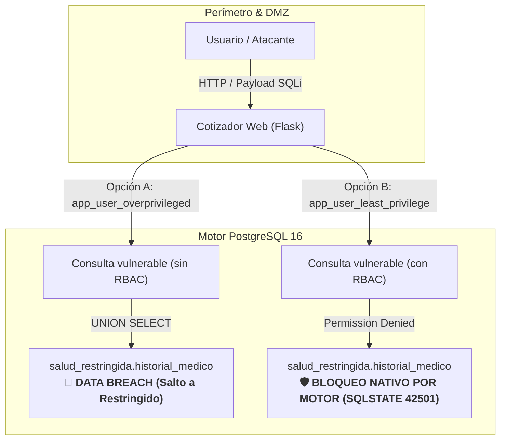

# Data Protection & Compliance — Sector Asegurador (Argentina)

[](LICENSE)
[](docs/ley-25326.md)
[](lab/README.md)

---

## De qué trata este proyecto

Este proyecto desarrolla un **programa de protección de datos personales, clasificación de la información y cumplimiento normativo (GRC)** modelado para una compañía de seguros en Argentina.

En una aseguradora conviven dos universos de datos muy distintos:
1. **Datos Contractuales y Comerciales (Nivel Confidencial):** Pólizas de automotor, hogar, DNI, datos de contacto y primas aseguradas.
2. **Datos Sensibles de Salud (Nivel Restringido):** Diagnósticos médicos, peritajes de siniestros laborales de ART, historias clínicas y dictámenes de incapacidad especialmente amparados por el **Artículo 7 de la Ley 25.326**.

El objetivo central es **cerrar la brecha entre las políticas de seguridad en papel y la arquitectura técnica de datos**. Para ello, el proyecto se estructura en dos pilares:
- Un **marco de análisis regulatorio y arquitectónico completo** documentado en [`docs/`](docs/).
- Una **Prueba de Concepto (PoC) técnica y ejecutable en PostgreSQL 16** alojada en [`lab/`](lab/), que demuestra empíricamente por qué la clasificación documental fracasa si la base de datos no implementa mínimo privilegio (RBAC) y cómo el motor nativo contiene el ataque.

---

## Índice de Documentación ([`/docs`](docs/))

El núcleo de análisis, clasificación y marco regulatorio del proyecto se encuentra estructurado en la carpeta [`docs/`](docs/):

| Documento | Temática Principal | Contenido Destacado |
|---|---|---|
| 📋 **[data-classification.md](docs/data-classification.md)** | **Matriz de Clasificación de Datos** | Matriz de 4 niveles adaptada a seguros, análisis de impacto (reputacional, legal y financiero) y análisis del caso real de ransomware en *La Segunda Seguros* (2023). |
| ⚖️ **[ley-25326.md](docs/ley-25326.md)** | **Marco Normativo Argentino** | Principios de calidad y finalidad, tutela de datos sensibles (Art. 7), deber de seguridad técnica (Art. 9 y Res. AAIP 47/2018), plazos de derechos ARCO y régimen penal (Ley 26.388). |
| 🔄 **[data-flow.md](docs/data-flow.md)** | **Flujo de Datos y Mapeo de Amenazas** | Diagrama de flujo de datos (DFD) del negocio asegurador, puntos de estrangulamiento (*choke points*) y mapeo de vectores de exfiltración con **MITRE ATT&CK**. |
| 🌍 **[gdpr-comparacion.md](docs/gdpr-comparacion.md)** | **Comparativa Internacional (GDPR)** | Comparación entre Ley 25.326 y el RGPD europeo: notificación obligatoria de brechas en 72h, principio de responsabilidad proactiva y estatus de adecuación de Argentina ante la UE. |
| 🛡️ **[security-controls.md](docs/security-controls.md)** | **Controles de Seguridad Técnicos** | Controles obligatorios por nivel (WORM anti-ransomware, DLP, RLS en base de datos) y tensiones operativas reales (cifrado vs rendimiento de índices). |

---

## Matriz de Clasificación de la Información

Para resolver la convivencia de pólizas y peritajes médicos sin caer en esquemas burocráticos o insuficientes, se definió un modelo operativo de **4 niveles** alineado con ISO/IEC 27001 (Control A.5.12) y la Resolución AAIP 47/2018:

| Nivel | Definición Operativa | Ejemplos en la Aseguradora | Impacto ante Fuga / Exposición |
|---|---|---|---|
| **1. Público** | Información deliberadamente destinada a divulgación externa. | Cotizaciones abiertas web, folletos comerciales de coberturas, comunicados de prensa. | Nulo. Solo exige controles de integridad contra desfiguración web (*defacement*). |
| **2. Interno** | Documentación de uso operativo exclusivo para empleados y colaboradores. | Procedimientos de suscripción, organigramas, manuales operativos, actas de comités. | Bajo/Medio. Exposición de procesos sin contingencia legal directa ni afectación a clientes. |
| **3. Confidencial** | Información contractual, comercial y datos personales (PII) de asegurados. | Pólizas de auto/hogar, DNI/CUIT, vigencias, primas emitidas, cuentas bancarias. | **Alto.** Infracción contractual, pérdida de asegurados y activación del deber de seguridad (Art. 9 Ley 25.326). |
| **4. Restringido** | **Datos especialmente protegidos (Salud y Seguridad):** historias clínicas y credenciales. | **Diagnósticos de ART**, peritajes de siniestros con lesiones, historias clínicas, credenciales maestras de base de datos. | **Crítico.** Infracción gravísima a datos sensibles (Art. 7 Ley 25.326), responsabilidad penal (Arts. 153 bis / 157 bis CP) y crisis reputacional. |

> **Principio de Segregación:** En una aseguradora, mientras un cliente cotiza o consulta una póliza automotor patrimonial (**Confidencial**), ese flujo no debe tener visibilidad ni acceso a los expedientes de peritajes médicos o siniestros laborales de ART (**Restringido**).

---

## Marco Regulatorio y Dilemas de Negocio

La arquitectura del proyecto responde a tres fricciones reales entre la normativa de protección de datos y la operación de sistemas:

1. **Protección Especial de Datos de Salud (Art. 2 y Art. 7 Ley 25.326):**  
   Los diagnósticos médicos no son un dato personal ordinario: su tratamiento está prohibido por defecto salvo consentimiento expreso o ley habilitante. No pueden coexistir en la misma bolsa de permisos que una póliza comercial.
2. **Plazos Estrictos de Derechos ARCO:**  
   La ley fija plazos perentorios para responder ante los titulares: **10 días corridos para Acceso** (Art. 14 inc. 2) y **5 días hábiles para Rectificación o Supresión** (Art. 16 inc. 2), exigiendo mecanismos eficientes de búsqueda y extracción en las bases de datos.
3. **El conflicto entre Supresión y Retención Obligatoria por Seguros:**  
   Si un asegurado exige suprimir sus datos tras rescindir una póliza, la aseguradora no puede eliminarlos a ciegas. La Superintendencia de Seguros de la Nación (SSN) y los plazos de prescripción del Código Civil y Comercial obligan a guardar registros de siniestros por hasta 10 años (en ART). La salida técnica adecuada es el **bloqueo y disociación de registros** (*tombstoning*), dejando los datos aislados exclusivamente para requerimientos judiciales o periciales.

---

## Validación Técnica: Prueba de Concepto en PostgreSQL 16 ([`lab/`](lab/README.md))

Para demostrar empíricamente por qué la clasificación en un documento de Word es inútil si la base de datos tiene permisos planos, se implementó un **laboratorio ejecutable en Docker**:



### El escenario demostrado:
* Un atacante aprovecha una vulnerabilidad web (**SQL Injection — MITRE ATT&CK T1190**) en el cotizador de pólizas.
* **Escenario Vulnerable:** Si la aplicación conecta con un usuario sobreprivilegiado, el atacante usa `UNION SELECT` para saltar del esquema `seguros_core` al esquema `salud_restringida` y extrae diagnósticos médicos de siniestros (**Salto de Confidencial a Restringido - Fuga Masiva**).
* **Mitigación por Mínimo Privilegio (RBAC):** Si la app conecta con una cuenta con privilegios mínimos, **el motor PostgreSQL rechaza la consulta nativamente con `SQLSTATE 42501 (INSUFFICIENT_PRIVILEGE)`**, conteniendo la brecha incluso con la aplicación web rota.
* **Mitigación en Software:** Demuestra cómo la parametrización de consultas (*Prepared Statements* con `%s`) neutraliza el vector en la capa de software.

### Cómo ejecutar la PoC (Guía rápida):
```bash
# 1. Levantar PostgreSQL 16 y la aplicación web
docker compose -f lab/docker-compose.yml up -d

# 2. Ejecutar la prueba automatizada del exploit y mitigación
docker compose -f lab/docker-compose.yml exec web python test_exploit.py
```
*(También se puede acceder vía navegador a `http://localhost:5000` para probar los payloads interactivamente. Para la guía paso a paso y detalles de configuración, consultar el [README del Laboratorio](lab/README.md)).*

---

## Estructura del Repositorio

```text
data-protection-compliance/
│
├── README.md                      # Marco general, clasificación y guía de navegación
├── LICENSE                        # Licencia MIT
│
├── docs/                          # Núcleo del Marco de Trabajo y Análisis de Cumplimiento
│   ├── data-classification.md     # Matriz de 4 niveles, análisis de impacto y caso La Segunda
│   ├── ley-25326.md               # Ley 25.326, Res. AAIP 47/2018 y delitos informáticos (Ley 26.388)
│   ├── data-flow.md               # Flujo de datos del negocio asegurador y mapeo MITRE ATT&CK
│   ├── gdpr-comparacion.md        # Comparación con GDPR, estatus de adecuación y notificación en 72h
│   └── security-controls.md       # Controles técnicos obligatorios por nivel y trade-offs
│
└── lab/                           # Prueba de Concepto Técnica (PostgreSQL 16 & Docker)
    ├── README.md                  # Instrucciones detalladas de ejecución de la PoC
    ├── docker-compose.yml         # Contenedores de PostgreSQL 16 y Flask
    ├── .env.example               # Variables de entorno y nota sobre credenciales
    ├── test_exploit.py            # Script CLI para verificar la contención por permisos
    ├── app/                       # Código de la aplicación web y dashboard interactivo
    └── db/                        # DDL de PostgreSQL (esquemas segregados y roles con RBAC)
```

---

## Controles y Secciones a Sumar (Roadmap a Futuro)

Este proyecto se enfoca en resolver la brecha entre la normativa de protección de datos personales y la base de datos (PostgreSQL 16). Para llevar este escenario a un nivel empresarial completo, se definen las siguientes líneas de trabajo y tecnologías a incorporar a futuro:

1. **Infraestructura como Código (IaC) para Backups Inmutables (Terraform / AWS S3 WORM)**

2. **Detección en Tiempo Real para SOC / SIEM (Reglas Sigma)**

3. **Prevención de Fuga de Datos (DLP)**

4. **Hardening Avanzado en PostgreSQL (Row-Level Security y Cifrado)**

---

## Decisiones de Diseño y Aprendizajes Técnicos

Durante el desarrollo del proyecto surgieron varios desafíos técnicos y de negocio que guiaron las decisiones de arquitectura:

1. **La importancia de contar con más controles que una sola tabla de permisos (Defensa en Profundidad):**  
   Vi con mis propios ojos que una configuración de permisos básica o una tabla de control de acceso por sí sola no es suficiente si la aplicación web contiene fallas o vulnerabilidades explotables. Por eso es indispensable combinar controles en capas: consultas preparadas en el software para neutralizar la inyección en la entrada, junto con segregación de esquemas y usuarios con mínimo privilegio para contener el impacto si la aplicación falla.

2. **El conflicto entre derecho de supresión y retención legal en seguros:**  
   En una aseguradora, el derecho del titular a exigir la supresión de sus datos entra en conflicto con las normativas de la Superintendencia de Seguros de la Nación y los plazos de prescripción de siniestros. Para resolverlo sin incumplir ninguna de las dos normativas, la salida adecuada no es borrar físicamente el registro, sino aplicar bloqueo y disociación (tombstoning), restringiendo el acceso exclusivamente a requerimientos judiciales o periciales.

3. **Criterio de clasificación de 4 niveles adaptado al sector asegurador:**  
   Los esquemas habituales de 3 niveles (Público, Interno, Confidencial) suelen cometer el error de agrupar datos personales comunes (DNI, contacto) con información de salud. Un modelo de 4 niveles (Público, Interno, Confidencial y Restringido) permite aislar bajo controles técnicos mucho más estrictos la información sensible amparada por el Art. 7 de la Ley 25.326 (historias clínicas, peritajes médicos de siniestros y diagnósticos de ART).

---

## Aclaraciones y Límites del Proyecto

- **Datos y Nombres Ficticios:** Todos los nombres, números de póliza y diagnósticos médicos del laboratorio son ficticios. El caso de *La Segunda Seguros* se toma como referencia exclusivamente a partir de notas de prensa y reportes públicos de 2023.
- **Credenciales en el Lab Local:** Las contraseñas están fijas en el código (`password_vulnerable_123`) a propósito para que el lab se pueda levantar y probar en local en un solo comando sin tener que armar un archivo `.env` o levantar un vault. En producción esto jamás se hace; se usan gestores de secretos (Vault / AWS Secrets Manager) o variables de entorno (ver [`lab/.env.example`](lab/.env.example)).
- **Alcance Legal:** Este trabajo es un ejercicio técnico y arquitectónico de seguridad informática; no reemplaza el dictamen de un abogado matriculado especialista en protección de datos personales.

---

## Fuentes Normativas Oficiales
- **Ley 25.326 — Protección de Datos Personales:** [InfoLEG](https://servicios.infoleg.gob.ar/infolegInternet/anexos/60000-64999/64790/texact.htm)
- **Ley 26.388 — Delitos Informáticos:** [InfoLEG](https://servicios.infoleg.gob.ar/infolegInternet/anexos/140000-144999/141790/norma.htm)
- **Resolución AAIP 47/2018 — Medidas de Seguridad:** [InfoLEG](https://servicios.infoleg.gob.ar/infolegInternet/anexos/310000-314999/312843/norma.htm)
- **Decisión de Adecuación UE 2003/490/CE (Ratificada 2024):** [EUR-Lex](https://eur-lex.europa.eu/legal-content/ES/TXT/?uri=CELEX%3A32003D0490)

---

## Autor
**Santiago D'Andrea**  
- GitHub: [@SantiagoDandrea](https://github.com/SantiagoDandrea)  
- Repositorio: [data-protection-compliance](https://github.com/SantiagoDandrea/data-protection-compliance)  
- Licencia: [MIT](LICENSE)
