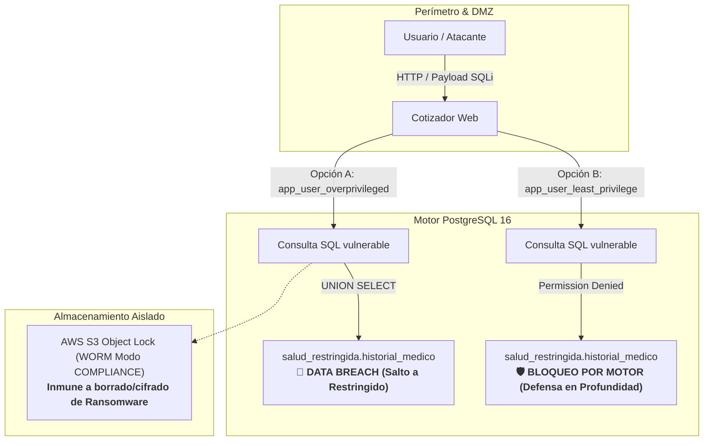

# Data Protection & Compliance — Sector Asegurador (Argentina)

[](LICENSE)
[](docs/ley-25326.md)
[](lab/README.md)

---

## De qué trata este proyecto

Armé este proyecto para bajar a tierra un problema clásico de seguridad y GRC (Gobierno, Riesgo y Cumplimiento) en el rubro asegurador argentino: la distancia que suele haber entre las políticas en papel ("cumplir con la Ley 25.326") y lo que pasa realmente en la base de datos cuando alguien programa mal un sistema.

En una compañía de seguros conviven dos mundos muy distintos:
1. Las pólizas comunes de autos o casas (**información confidencial**).
2. Los diagnósticos médicos de siniestros de ART o seguros de vida (**datos sensibles/restringidos** bajo el Art. 7 de la Ley 25.326).

Si un atacante encuentra una inyección SQL en el cotizador web público, ¿qué le impide saltar de una tabla de pólizas a leer los historiales médicos de los asegurados? Si la base de datos está conectada con un usuario con permisos amplios, absolutamente nada. La clasificación en un documento de Word no frena un ataque si no está implementada en los permisos del motor.

Para que esto no quede en un ensayo teórico, armé un **laboratorio ejecutable en Docker con PostgreSQL 16**:
- **Laboratorio Técnico Reproducible ([`lab/`](lab/README.md)):** Muestra en vivo cómo un ataque de SQLi (`UNION SELECT`) salta del esquema de pólizas al de salud si la app usa un usuario sobreprivilegiado, y cómo el motor de Postgres lo frena en seco con un error `SQLSTATE 42501 (INSUFFICIENT PRIVILEGE)` cuando aplicás mínimo privilegio (RBAC y esquemas separados), incluso con la web rota.
- **Controles prácticos:** Reglas de DLP con regex para DNI y términos médicos ([`dlp_rules.json`](lab/controls/dlp_rules.json)), un template de Terraform para backups inmutables en S3 con Object Lock COMPLIANCE ([`terraform_s3_worm_backup.tf`](lab/controls/terraform_s3_worm_backup.tf)) pensando en frenar ataques de ransomware como el que sufrió *La Segunda Seguros* en 2023, y scripts de hardening para PostgreSQL.
- **Detección para SOC:** Trazas sintéticas de ejemplo armadas a mano para mostrar qué eventos dispararía una regla Sigma en un SIEM ([`sigma_sqli_detection.yml`](lab/detection/sigma_sqli_detection.yml)).
- **Revisión normativa honesta:** Chequeé los artículos y plazos directamente en InfoLEG (plazos reales de 10 días corridos para acceso y 5 días hábiles para supresión) y corregí un error inicial que tenía con el Código Penal: el viejo Art. 117 bis fue derogado en 2008 por la Ley 26.388 de Delitos Informáticos, rigiendo hoy los Arts. 153 bis y 157 bis.

---

## El Problema: Del Cotizador a los Historiales Médicos

En una aseguradora, el cotizador web suele ser el front más expuesto. Si ese endpoint tiene una inyección SQL (`UNION SELECT`), el atacante intenta leer cualquier tabla del motor.



---

## Cómo Probar el Laboratorio (PostgreSQL 16)

El lab está armado para levantarse en dos patadas con Docker:

### 1. Levantar los contenedores:
```bash
docker compose -f lab/docker-compose.yml up -d
```
Esto levanta PostgreSQL 16 (con los esquemas `seguros_core` y `salud_restringida`, roles y datos de prueba ya cargados vía `init.sql`) y una app web en Flask.

### 2. Correr la prueba por consola:
Podés ejecutar el script de exploit directamente dentro del contenedor sin instalar nada en tu máquina:
```bash
docker compose -f lab/docker-compose.yml exec web python test_exploit.py
```
*(O desde tu terminal local si tenés Python con `psycopg2-binary`: `python lab/test_exploit.py`)*

El script hace cuatro pasos:
1. Tira una consulta normal de póliza (`POL-2026-001`).
2. Tira el exploit con el usuario sobreprivilegiado y te muestra los diagnósticos médicos en pantalla (**Data Breach**).
3. Tira el mismo exploit con el usuario de mínimo privilegio y muestra cómo Postgres aborta la consulta con `SQLSTATE 42501 (INSUFFICIENT_PRIVILEGE)`.
4. Muestra la solución en el código usando consultas preparadas (`%s`).

### 3. Probarlo desde el navegador:
Abrí `http://localhost:5000` en tu navegador. Armé una interfaz visual donde podés alternar entre el usuario vulnerable y el seguro, probar payloads con un clic y ver qué responde la base de datos en vivo.

---

## Estructura del Repositorio

```text
data-protection-compliance/
│
├── README.md                      # Explicación general, arquitectura y guía rápida
├── CHANGELOG.md                   # Bitácora de desarrollo, notas de auditoría y cambios (octubre 2026)
├── LICENSE                        # Licencia MIT
│
├── docs/                          # Documentación de análisis y marco regulatorio
│   ├── data-classification.md     # Matriz de 4 niveles, análisis de impacto y caso La Segunda
│   ├── security-controls.md       # Controles técnicos (WORM, DLP, RLS) y fricciones operativas
│   ├── data-flow.md               # Flujo de datos, diagrama de arquitectura y mapeo MITRE ATT&CK
│   ├── ley-25326.md               # Ley 25.326, Res. AAIP 47/2018 y delitos informáticos (Ley 26.388)
│   └── gdpr-comparacion.md        # Comparación con GDPR, estatus de adecuación y notificación en 72h
│
└── lab/                           # Laboratorio técnico reproducible (PostgreSQL 16)
    ├── README.md                  # Instrucciones detalladas del lab
    ├── docker-compose.yml         # Contenedores de PostgreSQL 16 y Flask
    ├── .env.example               # Ejemplo de variables de entorno y nota sobre credenciales
    ├── test_exploit.py            # Script CLI para ejecutar y verificar la mitigación
    ├── app/                       # Código de la aplicación web Flask y template
    ├── db/                        # init.sql con esquemas, datos y permisos de PostgreSQL
    ├── controls/                  # Controles aplicados (DLP regex, Terraform S3 WORM, RLS SQL)
    │   ├── dlp_rules.json         # Reglas de DLP para DNI, CUIT y CIE-10
    │   ├── terraform_s3_worm_backup.tf # IaC para backups inmutables anti-ransomware
    │   └── postgres_hardening.sql # Hardening con RLS y esquemas en PostgreSQL
    └── detection/                 # Muestras para monitoreo y SOC
        ├── sqli_waf.log           # Logs sintéticos de muestra (WAF y BD)
        └── sigma_sqli_detection.yml # Regla de detección Sigma para SIEM
```

---

## Lo que Aprendí en el Camino (Notas del Autor)

Armar este proyecto me sirvió para entender varios choques entre la teoría y la práctica:

1. **La clasificación en papel no frena a nadie si la BD no está segmentada:**  
   Al principio pensé que bastaba con armar una tabla y decir "esto es Confidencial" y "esto es Restringido". Recién cuando armé el lab de SQLi entendí que si la app web conecta con un usuario que tiene `SELECT` sobre todas las tablas, la clasificación no existe para un atacante. La defensa real exige **roles y esquemas separados en la base de datos**.

2. **El conflicto entre borrar datos y tener que guardarlos por ley en seguros:**  
   Fue un dolor de cabeza entender cómo conjugar el derecho de supresión (Art. 16 Ley 25.326) con las exigencias de la SSN y la prescripción civil/laboral (que puede llegar a 10 años en ART). Un cliente puede pedir que borres todo, pero la aseguradora no puede destruir pólizas si hay un reclamo latente. La salida técnica que encontré es el **bloqueo y disociación** (*tombstoning*), dejando los datos aislados solo para requerimientos periciales o judiciales.

3. **El riesgo de armar demasiados niveles de clasificación:**  
   Primero quise copiar el modelo de 5 niveles del NIST/DoD, pero para una empresa privada es inmanejable y nadie lo cumple. Después quise simplificarlo a 3 (Público, Interno, Confidencial), pero cometí el error de mezclar el DNI de un cliente con un diagnóstico de quimioterapia. El esquema de **4 niveles** fue el punto medio justo para aislar los datos sensibles del Art. 7 de la Ley 25.326.

4. **Revisión normativa (y corregir un error propio con el Código Penal):**  
   En los primeros borradores cité el Art. 117 bis del Código Penal como sanción penal. Al revisar en InfoLEG me di cuenta de que ese artículo fue **derogado en 2008 por la Ley 26.388 de Delitos Informáticos**, que incorporó los Arts. 153 bis (acceso ilegítimo) y 157 bis (difusión ilegítima). Asentar esa corrección en la bitácora fue parte de entender el marco legal vigente.

5. **Permisos en PostgreSQL y la herencia del rol PUBLIC:**  
   Al configurar PostgreSQL pensé que con hacer `REVOKE ALL ON SCHEMA salud_restringida FROM app_user_least_privilege` el esquema quedaba aislado. Un auditor me hizo notar dos cosas:
   - En Postgres los permisos son por lista blanca: si nunca le diste `GRANT SELECT` a ese usuario, ya de por sí no puede leer la tabla (el bloqueo real venía de no haberle dado `GRANT`, no del `REVOKE`).
   - Pero además, los esquemas nuevos conceden el permiso `USAGE` por omisión al rol `PUBLIC`. Si no hacés `REVOKE ALL ON SCHEMA salud_restringida FROM PUBLIC;`, cualquier usuario hereda ese `USAGE` y puede ver el esquema. Entender esa herencia vía `PUBLIC` fue un aprendizaje clave de DBA.

---

## Aclaraciones y Límites del Proyecto

- **Datos y Nombres Ficticios:** Todos los nombres, números de póliza y diagnósticos médicos del laboratorio son ficticios. El caso de *La Segunda Seguros* se toma como referencia exclusivamente a partir de notas de prensa y reportes públicos de 2023.
- **Credenciales en el Lab Local:** Las contraseñas están fijas en el código (`password_vulnerable_123`) a propósito para que el lab se pueda levantar y probar en local en un solo comando sin tener que armar un archivo `.env` o levantar un vault. En producción esto jamás se hace; se usan gestores de secretos (Vault / AWS Secrets Manager) o variables de entorno (ver [`lab/.env.example`](lab/.env.example)).
- **Logs Sintéticos:** Las trazas en `lab/detection/sqli_waf.log` no provienen de un WAF real corriendo en el contenedor ni de `pgaudit`, sino que son muestras armadas a mano para mostrar qué eventos disparan la regla Sigma sin tener que levantar un entorno pesado.
- **Alcance Legal:** Este trabajo es un ejercicio técnico y arquitectónico de seguridad informática; no reemplaza el dictamen de un abogado matriculado especialista en protección de datos personales.

---

## Fuentes Normativas Oficiales
- **Ley 25.326 — Protección de Datos Personales:** [InfoLEG](https://servicios.infoleg.gob.ar/infolegInternet/anexos/60000-64999/64790/texact.htm)
- **Ley 26.388 — Delitos Informáticos:** [InfoLEG](https://servicios.infoleg.gob.ar/infolegInternet/anexos/140000-144999/141790/norma.htm)
- **Resolución AAIP 47/2018 — Medidas de Seguridad:** [InfoLEG](https://servicios.infoleg.gob.ar/infolegInternet/anexos/310000-314999/312843/norma.htm)
- **Decisión de Adecuación UE 2003/490/CE (Ratificada 2024):** [EUR-Lex](https://eur-lex.europa.eu/legal-content/ES/TXT/?uri=CELEX%3A32003D0490)

---

## Autor
**Santiago D'Andrea**  
- GitHub: [@SantiagoDandrea](https://github.com/SantiagoDandrea)  
- Repositorio: [data-protection-compliance](https://github.com/SantiagoDandrea/data-protection-compliance)  
- Licencia: [MIT](LICENSE)
