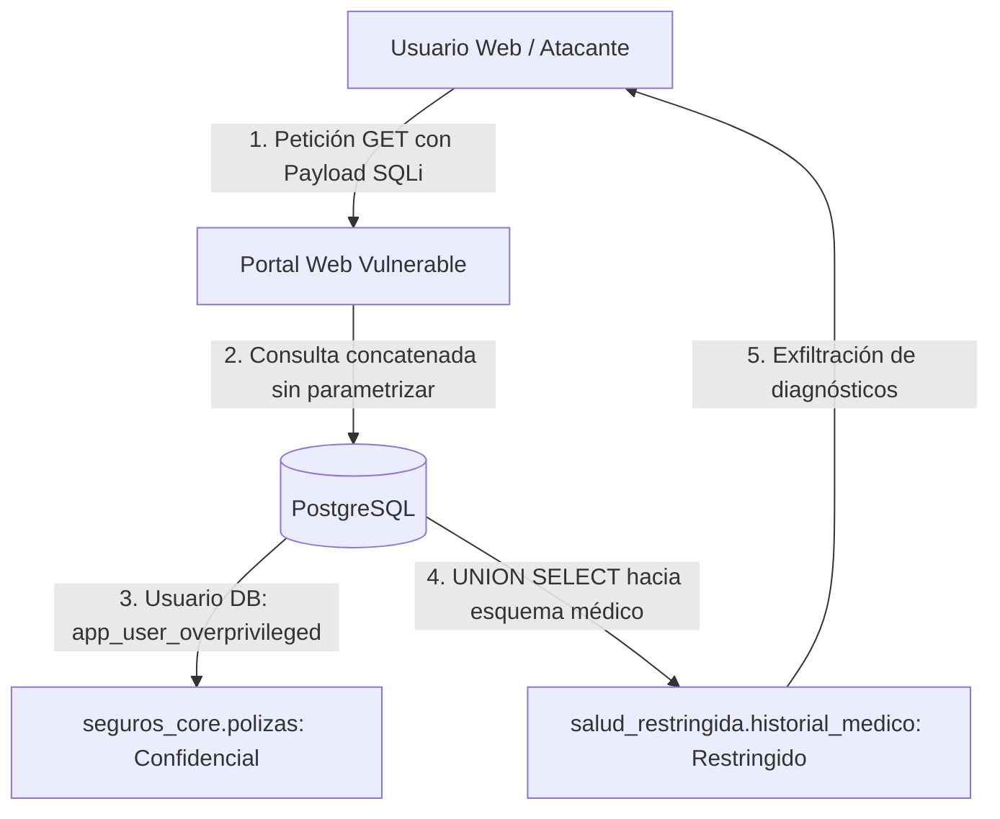

# Matriz de Clasificación de Datos — Aseguradora Argentina

## Marco de Referencia y Criterio de Diseño
Para estructurar la clasificación de datos en este proyecto evalué tres marcos de referencia principales y los contrasté con el marco normativo argentino:
- **ISO/IEC 27001:2022 — Control A.5.12:** Clasificación de la información según necesidades de confidencialidad, integridad y disponibilidad.
- **NIST SP 800-60:** Mapeo de tipos de información a categorías de impacto sobre la seguridad.
- **Ley 25.326 & Resolución AAIP 47/2018:** Definición formal de datos sensibles (salud, vida sexual, convicciones) y medidas de seguridad técnicas recomendadas para medios informatizados.

El criterio rector no es simplemente el nombre del campo o archivo, sino **qué daño operativo, legal y financiero se materializa si ese dato es expuesto, alterado o retenido indebidamente**.

---

## Niveles de Clasificación

| Nivel | Definición Operativa | Criterio de Impacto y Sanción |
|---|---|---|
| **Público** | Información deliberadamente destinada a divulgación masiva. | Impacto nulo ante divulgación. Solo requiere controles de integridad contra desfiguración (*defacement*). |
| **Interno** | Información operativa de uso exclusivo del personal de la compañía. | Impacto bajo a moderado. Su exposición revela procesos internos o metodologías de trabajo sin comprometer datos de clientes ni generar contingencias regulatorias directas. |
| **Confidencial** | Información contractual, financiera o de identificación personal (PII) de asegurados y proveedores. | Impacto alto. Su filtración activa el deber de seguridad del Art. 9 de la Ley 25.326, genera pérdida de clientes y potenciales demandas por incumplimiento contractual. |
| **Restringido** | Datos especialmente protegidos: información médica, diagnósticos de siniestros, credenciales maestras y llaves criptográficas. | Impacto crítico. Infracción directa a la tutela de datos sensibles (Art. 7 Ley 25.326), contingencias penales (Arts. 153 bis y 157 bis CP) y pérdida de autorización para operar ante la SSN. |

---

## Ejemplos Concretos en una Aseguradora

| Nivel | Ejemplos del Negocio Asegurador |
|---|---|
| **Público** | Cotizaciones estándar públicas, formularios de contacto web, folletos de coberturas, comunicados de prensa. |
| **Interno** | Organigrama, directivas internas de suscripción, actas de comité operativo, presupuestos no ejecutados. |
| **Confidencial** | Número de póliza, DNI/CUIT de asegurados, vigencia, coberturas contratadas, primas emitidas, historial comercial de siniestros automotores (sin lesiones). |
| **Restringido** | **Historias clínicas**, diagnósticos médicos, dictámenes de incapacidad laboral de ART, peritajes psicológicos, datos biométricos, claves privadas de certificados TLS, credenciales de conexión a bases de datos y llaves maestras de KMS. |

> **Lección del sector:** En una aseguradora conviven coberturas patrimoniales (autos, hogar) con coberturas sobre personas (vida, salud, ART). Mientras que los datos de una póliza automotor son **Confidenciales**, en cuanto interviene un siniestro con lesionados o un reclamo laboral, el expediente incorpora datos médicos protegidos como **Restringidos**.

---

## Análisis de Impacto y Métricas de Riesgo

El impacto se analiza en tres dimensiones, ponderado por la **volumetría** del incidente:

### 1. Nivel Confidencial (Datos Contractuales / PII)
- **Riesgo:** Alto. Atractivo para estafas dirigidas y phishing a asegurados.
- **Impacto Legal:** Incumplimiento del Art. 9 de la Ley 25.326 (falta de diligencia técnica).
- **Impacto Financiero:** Costos de atención a clientes, mediaciones comerciales y rescisiones de pólizas.
- **Umbral de Severidad:** La filtración de 100 pólizas es un incidente operativo; la exfiltración de 50.000 pólizas es una crisis corporativa con daño reputacional irreversible.

### 2. Nivel Restringido (Salud / Credenciales de Infraestructura)
- **Riesgo:** Crítico. Exposición de la intimidad más sensible de las personas.
- **Impacto Legal:** Infracción muy grave ante la AAIP (Art. 7 Ley 25.326), acciones por daños y perjuicios morales y denuncias penales por violación de secretos.
- **Impacto Financiero:** Costos forenses de respuesta a incidentes (IR), honorarios legales de litigios colectivos, rescate extorsivo (en caso de no contar con backups aislados) y multas regulatorias.

---

## Caso Real: Ransomware en Aseguradora Argentina (La Segunda Seguros, 2023)

En febrero de 2023, la compañía argentina **La Segunda Seguros** sufrió un incidente masivo atribuido al grupo **LockBit**.

Los atacantes no se limitaron a cifrar los servidores para exigir rescate: aplicaron la técnica de **doble extorsión**, exfiltrando cientos de gigabytes de datos antes del cifrado.

Al publicar los datos en sitios de la dark web, se comprobó que los repositorios contenían simultáneamente:
- Pólizas comerciales y datos de contacto de clientes (**Confidencial**).
- Diagnósticos psiquiátricos, peritajes médicos de juicios laborales y antecedentes de salud de asegurados (**Restringido**).
- Credenciales internas de sistemas y copias de seguridad de bases de datos (**Restringido**).

**Conclusión práctica del incidente:** Si no existe una separación arquitectónica estricta (segmentación lógica de redes y bases de datos), el compromiso de un único host administrativo permite al atacante capturar datos de todos los niveles de clasificación indistintamente.

---

## Caso Práctico Ejecutable: SQL Injection y Salto de Clasificación

Para entender la brecha entre la clasificación teórica y la realidad de los sistemas, consideremos una aplicación web de consulta de pólizas conectada a una base de datos relacional:



### El Antipatrón de Base de Datos
Si la aplicación web conecta a la base de datos utilizando un único usuario con privilegios `SELECT` sobre todas las tablas del negocio:

```sql
-- Petición normal esperada:
SELECT numero_poliza, titular, cobertura, prima FROM polizas WHERE numero_poliza = 'POL-2024-001';

-- Payload del atacante (MITRE ATT&CK T1190 / T1005):
POL-9999' UNION SELECT dni, paciente, diagnostico, tratamiento FROM historial_medico --
```

El atacante utiliza un parámetro público de pólizas para saltar al esquema de salud. **La clasificación fracasó porque no se tradujo en permisos de base de datos.**

### Verificación Práctica en el Laboratorio
Este vector fue implementado como un laboratorio ejecutable en la carpeta [`lab/`](../lab/README.md):

```bash
# Ejecutar la verificación técnica directa contra PostgreSQL 16:
docker compose -f lab/docker-compose.yml exec web python test_exploit.py
# (O desde el host si tienes psycopg2: python lab/test_exploit.py)
```

El script demuestra:
1. La exfiltración exitosa de diagnósticos oncológicos y traumatológicos bajo el rol `app_user_overprivileged`.
2. La mitigación inmediata cuando la misma consulta se procesa bajo el rol `app_user_least_privilege` (devolviendo `Permission denied for table historial_medico`).

---

## Decisiones de Diseño y Opciones Descartadas

Al estructurar este modelo tomé decisiones que descartaron alternativas comunes en la industria:

1. **¿Por qué 4 niveles y no el estándar militar de 5 niveles (NIST/DoD)?**  
   *Descartado:* Esquemas con *Unclassified, Restricted, Confidential, Secret, Top Secret* son viables en defensa o gobierno, pero en una empresa privada añaden burocracia que los empleados terminan ignorando. Cuatro niveles representan el balance justo entre granularidad y adopción real.

2. **¿Por qué no simplificarlo a 3 niveles (Público, Interno, Confidencial)?**  
   *Descartado:* Este fue mi primer impulso. Sin embargo, al cruzarlo con la Ley 25.326, descubrí que unificar el DNI de un cliente con su diagnóstico médico bajo la misma etiqueta "Confidencial" generaba un error grave de arquitectura: obligaba a aplicar los mismos controles caros (tokenización, cifrado de campo, RLS) a una prima de seguro de auto que a un historial de quimioterapia, o peor, dejaba desprotegido el historial de quimioterapia con controles básicos. La categoría **Restringido** es indispensable para aislar los datos sensibles del Art. 7.

---

## Preguntas Abiertas y Deuda Técnica

- **Clasificación en Datos no Estructurados:** La matriz resuelve con precisión el modelo para bases de datos relacionales. Sin embargo, el 60% de la información médica en aseguradoras ingresa como archivos adjuntos no estructurados (PDFs escaneados de peritajes, imágenes de certificados médicos enviadas por WhatsApp o email). Mapear y etiquetar automáticamente esos adjuntos requiere herramientas de clasificación por OCR/NLP que suelen tener tasas altas de falsos negativos.
- **Tratamiento de la Cláusula de Interés Legítimo:** A diferencia del GDPR, la Ley 25.326 no reconoce explícitamente el *interés legítimo* como base jurídica autónoma, lo que genera dudas operativas sobre el uso de datos internos para analítica antifraude.

---

## Siguientes Pasos
Para ver cómo se traducen estos niveles en controles criptográficos, roles de acceso y monitoreo, continuar en [Controles de Seguridad](security-controls.md) o explorar el flujo en [Flujo de Datos](data-flow.md).