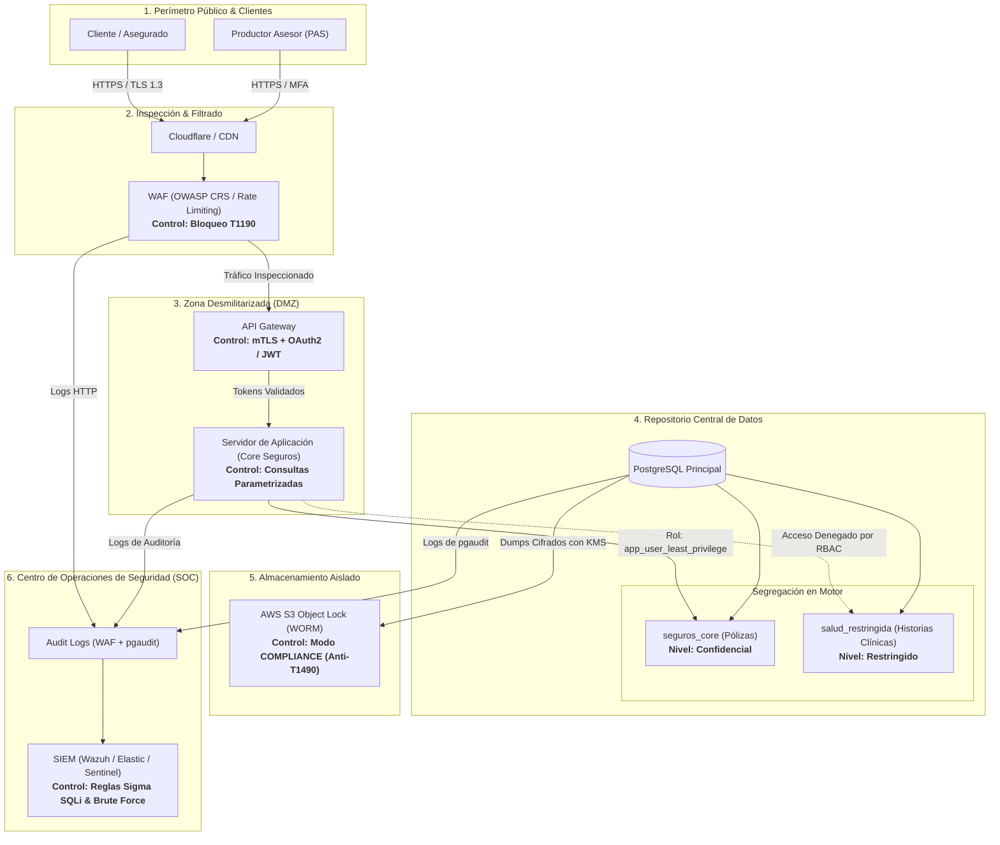

# Flujo de Datos y Mapeo de Amenazas (MITRE ATT&CK)

## Objetivo Arquitectónico
Analizar el flujo de datos dentro de una aseguradora permite identificar el ciclo de vida de la información: desde que ingresa por el portal público hasta que se procesa en el backend, se almacena en bases de datos relacionales, se respalda en repositorios inmutables y se audita en el SIEM.

Cada salto entre componentes representa una frontera de confianza (*Trust Boundary*) donde los niveles de clasificación definidos en [data-classification.md](data-classification.md) deben ser forzados por los controles de [security-controls.md](security-controls.md).

---

## Diagrama de Arquitectura y Fronteras de Control

---

## Mapeo Completo de Amenazas: MITRE ATT&CK vs. Flujo de Datos

A diferencia de un análisis genérico centrado únicamente en inyecciones web, una aseguradora enfrenta un abanico de tácticas y técnicas de adversarios reales (como se constató en incidentes de ransomware como LockBit):

| Salto del Flujo | Amenaza Identificada | Técnica MITRE ATT&CK | Nivel Comprometido | Mitigación Técnica / Blue Team |
|---|---|---|---|---|
| **Cliente → Web** | Robo de credenciales de portal de asegurados / Productores (PAS). | **T1078 — Valid Accounts** **T1110 — Brute Force** | Confidencial | MFA obligatorio (FIDO2 / TOTP), Rate limiting y bloqueo por IP/reputación en WAF. |
| **Web → API** | Explotación de vulnerabilidad de software en cotizador de pólizas. | **T1190 — Exploit Public-Facing Application** | Confidencial → Restringido | Reglas WAF (OWASP CRS), consultas parametrizadas obligatorias y escaneo SAST/DAST en CI/CD. |
| **Servidor → DB** | Volcado de datos médicos mediante escalamiento de esquema en SQLi. | **T1005 — Data from Local System** **T1068 — Exploitation for Privilege Escalation** | Restringido (Salud) | Segregación de roles (`app_user_least_privilege`), revocación de acceso a `salud_restringida`, RLS. |
| **Terminal → Email** | Empleado o perito médico reenvía legajos de ART a casilla personal. | **T1567 — Exfiltration Over Web Service** **T1052 — Exfiltration Over Physical Medium** | Restringido | Agente DLP perimetral bloqueando regex de DNI/CIE-10 ([`dlp_rules.json`](../lab/controls/dlp_rules.json)) y bloqueo de puertos USB. |
| **DB → Almacenamiento** | Actor malicioso despliega ransomware para extorsión y paralización. | **T1486 — Data Encrypted for Impact** | Confidencial / Restringido | EDR con comportamiento antimalware, microsegmentación de red y principio de mínimo privilegio. |
| **DB → Backup** | Atacante intenta destruir o cifrar las copias de seguridad de siniestros. | **T1490 — Inhibit System Recovery** | Restringido | Backups inmutables con **S3 Object Lock en modo COMPLIANCE** ([`terraform_s3_worm_backup.tf`](../lab/controls/terraform_s3_worm_backup.tf)). |
| **Eventos → SIEM** | Intento de evasión o borrado de trazas de acceso indebido. | **T1070 — Indicator Removal** | Interno / Confidencial | Envío continuo de logs por syslog seguro hacia SIEM con retención *Append-Only* inmutable. |

---

## Puntos de Estrangulamiento (*Choke Points*) Críticos

En defensa en profundidad, un *choke point* es un cuello de botella arquitectónico donde el equipo de seguridad puede detener un ataque antes de que alcance la información más crítica:

1. **La frontera entre la aplicación y el motor de datos:**  
   Si el atacante burla el WAF y encuentra un fallo de código (T1190), el *choke point* es el usuario de base de datos. Si el usuario de base de datos tiene permisos globales, la brecha es total. Si el usuario está encapsulado en el esquema de pólizas, la intrusión queda contenida sin fuga de diagnósticos médicos. *(Demostrado en [`lab/test_exploit.py`](../lab/test_exploit.py))*.

2. **La frontera entre el entorno de producción y el vault de backups:**  
   Si el atacante toma el control del Directorio Activo (Dominio), intentará borrar los backups para obligar al rescate. El *choke point* es el aislamiento del repositorio S3 en una cuenta de AWS independiente con Object Lock activado, impidiendo que credenciales del dominio de producción puedan alterar las copias.

---

## Verificación de Detección en SOC
Los eventos generados a lo largo de este flujo son capturados en la traza [`lab/detection/sqli_waf.log`](../lab/detection/sqli_waf.log) y activan la alerta [`lab/detection/sigma_sqli_detection.yml`](../lab/detection/sigma_sqli_detection.yml), garantizando que el SOC disponga de contexto forense para iniciar el triaje en menos de 15 minutos.
